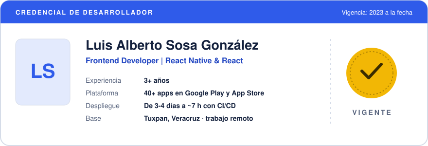
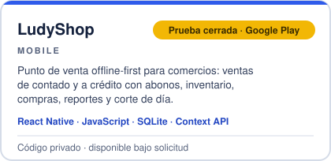
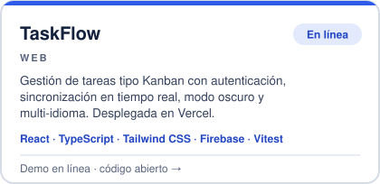
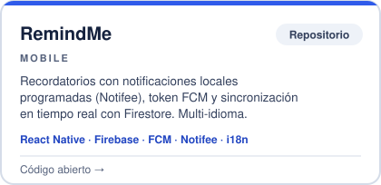
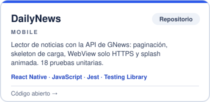

<a href="https://sosadev.online">
  <picture>
    <source media="(prefers-color-scheme: dark)" srcset="assets/credencial-oscuro.svg">
    
  </picture>
</a>

  
  
  

## Sobre mí

Desarrollador **React Native** con 3+ años de experiencia. Soy responsable del desarrollo móvil de una plataforma white-label multi-tenant con **40+ apps** publicadas en Google Play y App Store. Diseñé e implementé su pipeline de CI/CD, que pasó el despliegue de **3-4 días** de trabajo manual a **~7 horas** automatizadas.

Desarrollo apps offline-first con Expo, TypeScript y SQLite, y aplicaciones web con React. Ingeniero en TIC titulado.

## Stack

**Mobile** 

**Datos** 

**Web** 

**Backend y cloud** 

**DevOps y publicación** 

**Calidad** 

## Proyectos

  <a href="https://sosadev.online/#proyectos"><picture><source media="(prefers-color-scheme: dark)" srcset="assets/proyectos/ludyshop-oscuro.svg"></picture></a>
  <a href="https://sosadev.online/#proyectos"><picture><source media="(prefers-color-scheme: dark)" srcset="assets/proyectos/justiprecio-oscuro.svg"></picture></a>
  <a href="https://github.com/sosagonzales0409-max/taskflow"><picture><source media="(prefers-color-scheme: dark)" srcset="assets/proyectos/taskflow-oscuro.svg"></picture></a>
  <a href="https://github.com/sosagonzales0409-max/Remindme"><picture><source media="(prefers-color-scheme: dark)" srcset="assets/proyectos/remindme-oscuro.svg"></picture></a>
  <a href="https://github.com/sosagonzales0409-max/NewsApp"><picture><source media="(prefers-color-scheme: dark)" srcset="assets/proyectos/dailynews-oscuro.svg"></picture></a>

El código de LudyShop y JustiPrecio es privado y está disponible para revisión técnica bajo solicitud. Demo de TaskFlow: <a href="https://taskflow-lake-five.vercel.app">taskflow-lake-five.vercel.app</a>

Más detalle de mi experiencia y proyectos en <a href="https://sosadev.online"><b>sosadev.online</b></a>

